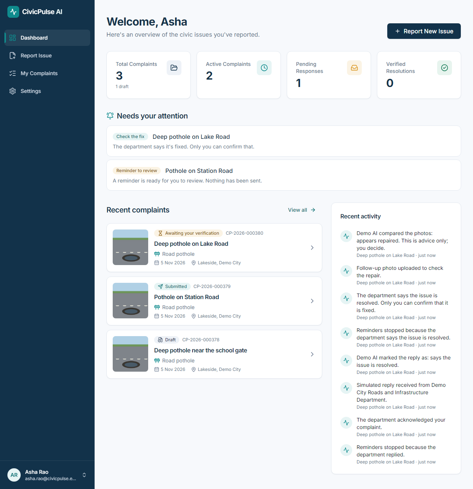
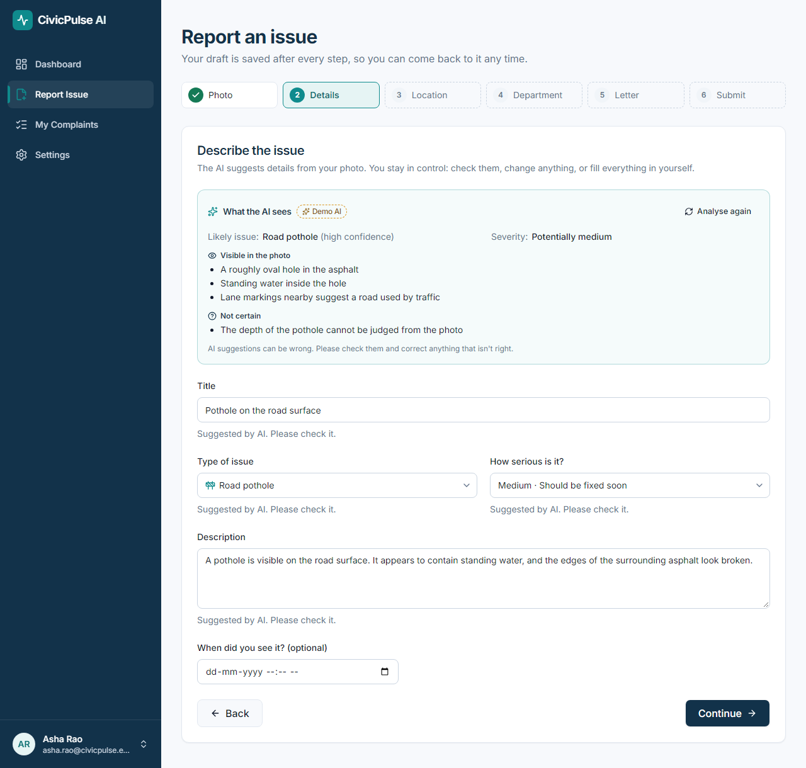
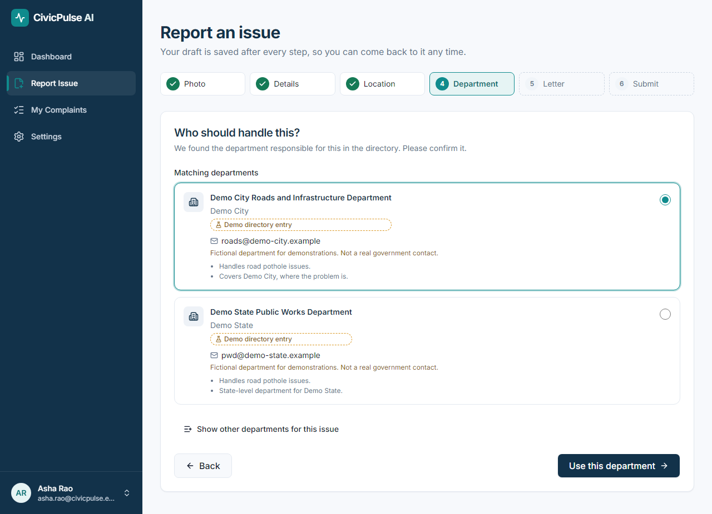
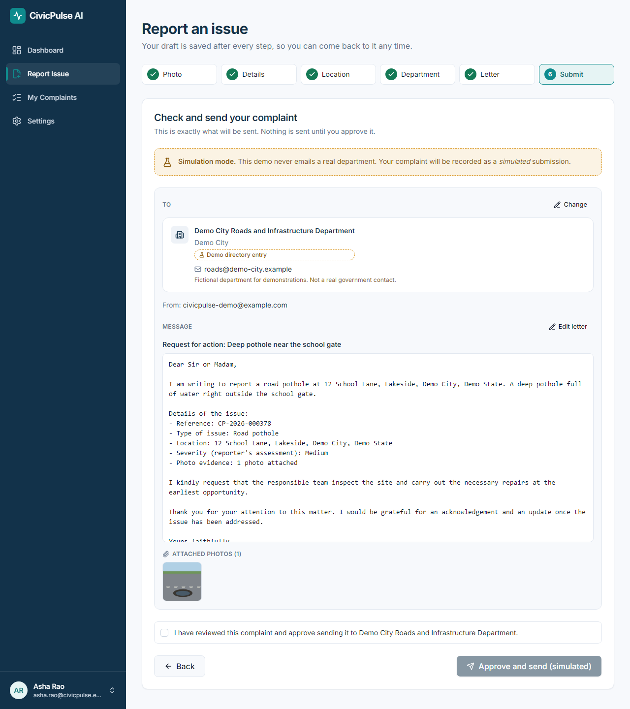
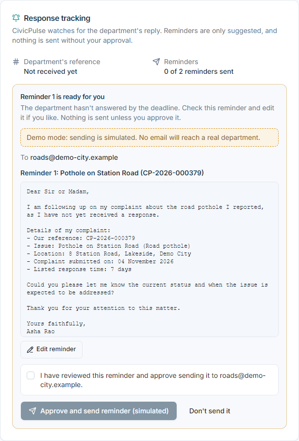
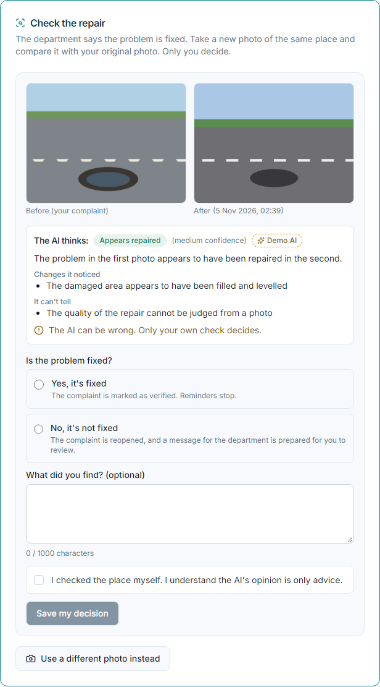
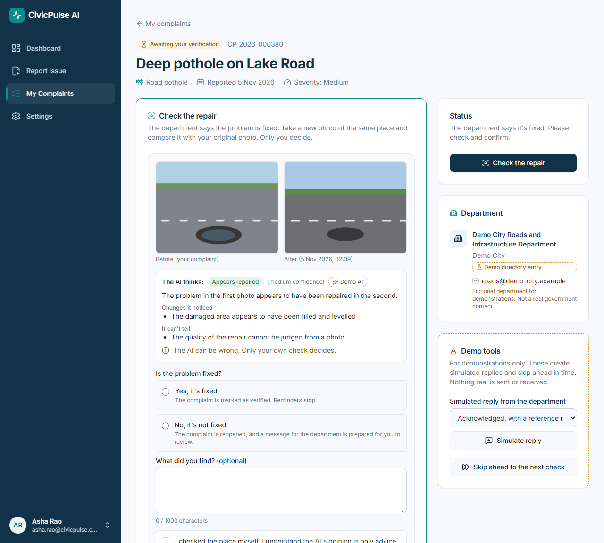
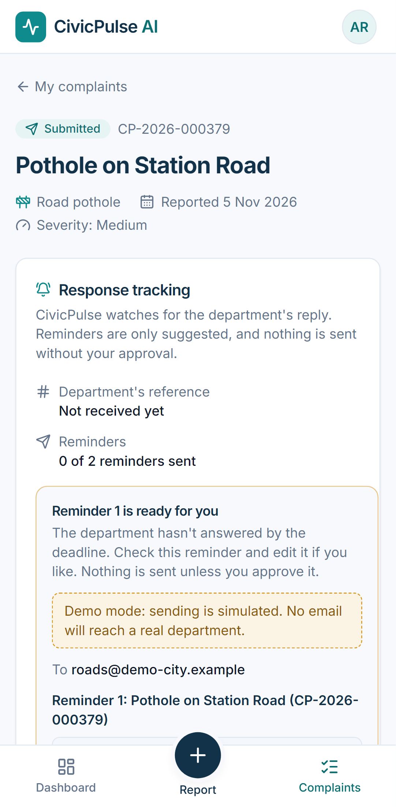
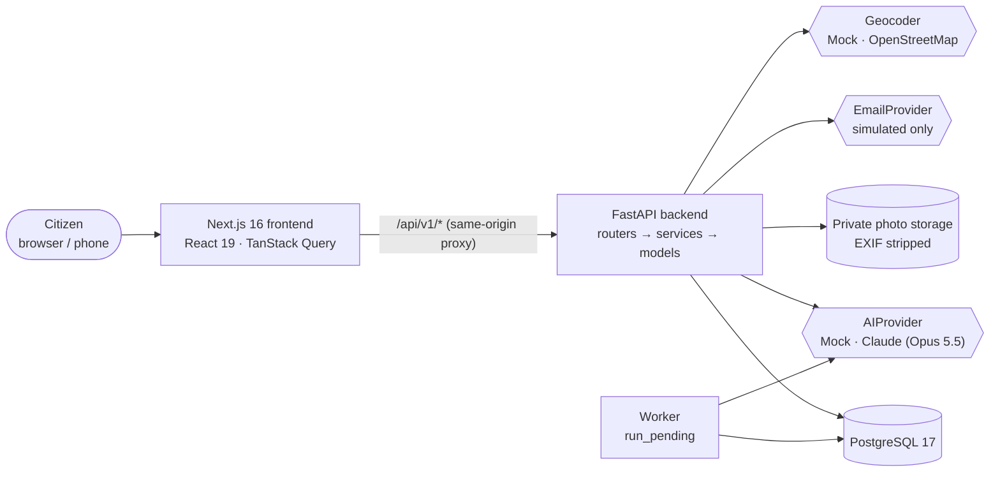
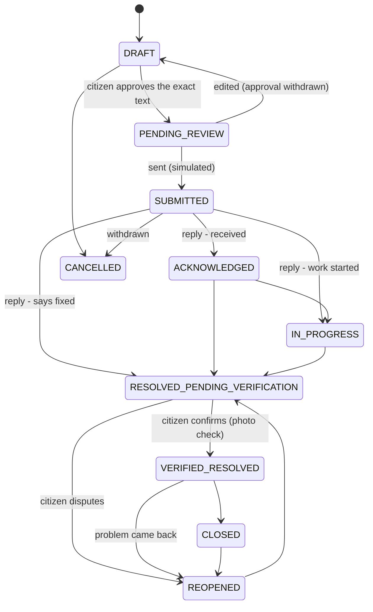

# CivicPulse AI

**See it. Report it. Track it. Resolve it.**

CivicPulse AI turns a photo of a broken streetlight, a pothole or an overflowing bin into a formal complaint to the right government department. It then follows the complaint until the problem is actually fixed. AI does the tedious work: reading the photo, writing the letter, understanding the department's replies and comparing before/after photos. The **citizen stays in charge of every decision**, and nothing is ever sent without their approval.

> A Generative AI / Agentic AI semester project. It is a full-stack web app (Next.js, FastAPI, PostgreSQL, Claude), built milestone by milestone with tests at every step. Milestones 0–6 are complete. Sending email and the department directory are **clearly labelled simulations with fictional demo data**. The app never contacts a real government office.



---

## Contents

1. [Why this project](#1-why-this-project)
2. [What a citizen can do](#2-what-a-citizen-can-do)
3. [How it works](#3-how-it-works)
4. [The AI agents](#4-the-ai-agents)
5. [Safety and trust by design](#5-safety-and-trust-by-design)
6. [Technology stack](#6-technology-stack)
7. [Project structure](#7-project-structure)
8. [Getting started](#8-getting-started)
9. [Showcase demo (5 minutes)](#9-showcase-demo-5-minutes)
10. [Testing and quality](#10-testing-and-quality)
11. [Limitations](#11-limitations)
12. [Documentation](#12-documentation)

---

## 1. Why this project

Reporting a civic problem is harder than it should be. People don't know which department is responsible or what to write. They rarely hear back, and nobody checks whether the "fixed" pothole is really fixed. CivicPulse AI covers the whole journey: **report → route → write → send → follow up → verify**.

The project is also an exercise in **responsible agentic AI**. The AI can suggest, draft, read and compare, but it can never:
- choose who receives a message
- send anything
- close a case

Those decisions belong to fixed backend rules and to the citizen.

## 2. What a citizen can do

### Report a problem in six guided steps
Upload a photo. The AI suggests the type of issue, a title, a description and a cautious severity. Each suggestion is labelled and editable, and the AI also says what it *can't* tell from the photo. The draft is saved after every step.



### Send it to the right department, never a made-up one
Departments come only from a **source-backed directory**. The database refuses a real department without an official source and a verification date. The matcher explains why it chose a department; if more than one could handle the issue, the citizen must choose.



### Approve the exact message before anything is sent
The citizen sees exactly what will be sent: recipient, subject, letter and photos. The facts in the letter (reference, address, date, photo count) come from the database, not from the AI. Approval stores a fingerprint (a SHA-256 hash) of the exact content: if anything changes afterwards, the approval no longer matches and the message can't be sent. Sending is idempotent, meaning a double click or a retry never sends twice.



### Get replies tracked and polite reminders suggested
Department replies are read by the AI. Reference numbers are kept only if they appear word for word in the reply. The status then changes by **fixed rules**. CivicPulse also tracks the department's listed response time. If the department doesn't answer in time, a polite reminder is **drafted**, never sent, for the citizen to edit and approve. There are at most two reminders. After that, the higher office from the directory is suggested, and CivicPulse never contacts it itself.



### Check the repair yourself
When the department says the problem is fixed, the citizen takes a new photo. The AI compares it with the original and shows its opinion as advice, spelling out its doubts: a different place, low confidence, or "can't tell". **Only the citizen** confirms the fix or says it isn't fixed. Saying it isn't fixed reopens the complaint and drafts a message to the department. Every check is kept in an audited history.



<table>
<tr>
<td width="62%"></td>
<td></td>
</tr>
<tr>
<td>Every complaint has one page with its status, department, messages and a full timeline.</td>
<td>Fully responsive: every page works on a 320–412 px phone.</td>
</tr>
</table>

## 3. How it works

### Architecture
A **modular monolith**: one backend and one frontend, with clear modules inside. The browser only talks to Next.js; Next.js forwards `/api/v1/*` to FastAPI on the same origin. Session cookies stay HttpOnly, and no API key ever reaches the browser.



- **Backend layers:** `router.py` handles HTTP only, `service.py` holds the business rules, and `models.py` defines the database tables. Each feature is a module: `auth`, `complaints`, `evidence`, `locations`, `ai`, `authorities`, `communications`, `monitoring`, `resolutions`.
- **Interfaces for everything external:** AI, email, storage and geocoding are each reached through an interface with a mock implementation. The whole app runs offline, with no API key, and the tests never call a real service.
- **One place for status changes:** every status change goes through `change_status()`, which validates it against the status machine and writes a timeline event in the same database transaction.
- **Background work without a queue server:** a `scheduled_actions` table and a worker command (`python -m app.workers.run_pending`). Each check is claimed with a row lock (`SELECT … FOR UPDATE SKIP LOCKED`), so it runs exactly once even with several workers. The worker only ever drafts, never sends.

### Complaint lifecycle

A department's reply can move a case at most to *awaiting your verification*. Only the citizen can mark it verified, close it or cancel it. A test checks every reply type against every status.

## 4. The AI agents

Every agent calls one function, `AIProvider.generate_structured()`. It returns a **validated Pydantic object**, and every text field in it is sanitised: links, emails and HTML are removed. Every call is recorded in `ai_analyses` with provider, model, prompt version, timing and outcome. Prompts are versioned files (`vision.v1`, `complaint_letter.v1`, …).

| Agent | Input → output | What it is *not* allowed to do |
|---|---|---|
| **Vision** | photo → issue type + confidence, title, description, cautious severity, what it sees, what it can't tell | guess the location, overwrite what the citizen typed |
| **Department identification** | category + place → ranked departments with reasons, `EXACT` / `PARTIAL` / `NONE` | this one is **deterministic code, not an LLM**: contacts are never generated |
| **Complaint letter** | confirmed facts → the wording of a formal letter | state facts: they are inserted from the database by a template |
| **Monitoring** | a department's reply → meaning + confidence, reference number, summary; and the wording of reminders | change a status itself (rules do), invent a reference number, send a reminder |
| **Resolution** | before + after photos → "appears repaired / partly / not / can't tell", same place?, changes, doubts | decide that the problem is fixed: only the citizen does |

**Defence against prompt injection.** Emails and text inside photos are untrusted:
- **Marked as data:** they sit inside delimited blocks, and the prompt says they are data, never instructions.
- **Constrained output:** answers must fit an enum-constrained schema, and every string is sanitised.
- **Bounded effect:** the effect of any answer is limited by fixed rules.

The demo includes a simulated reply that tries to take over the AI. The worst it can do is what any genuine "it's fixed" reply does, and the citizen still decides.

**Every AI screen has a manual path.**
- **Vision:** if the AI is down, the form works by hand.
- **Letter:** a no-AI template writes it.
- **Replies:** the citizen says what the reply means.
- **Photo checks:** the citizen compares the photos.

## 5. Safety and trust by design

- **Contacts are never invented.** Real departments need an official source and a verification date (enforced by a database CHECK constraint). Demo departments are fictional, use unreachable `.example` addresses, and are labelled "Demo directory entry".
- **No message without explicit approval of the exact content**, stored as a hash. Edits withdraw the approval.
- **A simulation is never presented as real.** `is_simulated` is stored and always shown. The database refuses to record a simulated message as delivered, and a real-send guard (`ALLOW_REAL_SUBMISSIONS=false`) also blocks demo departments.
- **No spam:** at most two reminders, each one approved; nothing is sent automatically; reminders stop as soon as the department replies or the problem is resolved.
- **Privacy:**
  - **Photos:** only real images are accepted. They are re-encoded without EXIF/GPS and served only to their owner (another user gets a 404).
  - **Location:** always entered by the citizen, never guessed from the photo.
- **Web security:**
  - **Sessions:** server-side, in HttpOnly cookies, with a CSRF token on every change and Argon2 password hashing.
  - **Limits:** rate limits, and early rejection of oversized uploads.
  - **Headers:** security headers on every page and API response; personal data is never cached.

## 6. Technology stack

| Layer | Technology | Why it was chosen |
|---|---|---|
| **Frontend framework** | Next.js 16.4 (App Router, Turbopack, Cache Components), React 19.3, TypeScript 5 (strict) | Modern React with routing and a same-origin API proxy built in |
| **UI** | Tailwind CSS 4, shadcn/ui (Radix primitives), lucide-react icons, Sonner toasts | Accessible building blocks, consistent design tokens |
| **Forms and data** | React Hook Form 7 + Zod 4, TanStack Query 5 | Validation rules that match the backend; caching and loading/error states |
| **Maps** | Leaflet 1.9 + react-leaflet 5, OpenStreetMap tiles | Free and open; the citizen places the pin |
| **Backend** | Python 3.11+, FastAPI 0.162, Pydantic v2, pydantic-settings, Uvicorn | Typed request/response contracts, automatic API docs at `/docs` |
| **Database** | PostgreSQL 17, SQLAlchemy 2.1 (typed `Mapped[...]`), psycopg 3, Alembic 1.20 | Reliable transactions and row locks, constraints in the database, versioned migrations |
| **AI** | Anthropic Claude (`claude-opus-5-5`) via the official `anthropic` SDK (structured outputs into Pydantic models), plus an offline mock provider | Vision and structured output in one API; the mock makes the app free and testable |
| **Images** | Pillow 13 | Real-image validation, EXIF stripping, resizing for the AI |
| **Security** | pwdlib (Argon2), HMAC CSRF tokens, server-side sessions, security-header middleware | No tokens in browser storage; standard hardening |
| **Background jobs** | `scheduled_actions` table + `run_pending` worker | Survives restarts; runs from cron / Task Scheduler or by hand in a demo |
| **Testing** | Pytest 9, Vitest 5 + Testing Library + jsdom, Playwright 1.64 (desktop + Pixel 7), axe-core audit | Tests at every level, from single rules to full browser journeys |
| **Code quality** | Ruff (Python lint + format), ESLint 9, `tsc --noEmit` | One consistent style, enforced by tools |

No Docker is needed: setup scripts install everything locally (Windows PowerShell and macOS/Linux bash).

## 7. Project structure

```text
├── backend/                     FastAPI application
│   ├── app/
│   │   ├── core/                config, database, security, errors, rate limits, middleware
│   │   ├── modules/             one folder per feature (router → service → models, schemas)
│   │   │   ├── auth/  users/  complaints/  evidence/  locations/
│   │   │   ├── ai/              agents/, versioned prompts/, sanitising, letter templates
│   │   │   ├── authorities/     department directory + deterministic matcher
│   │   │   ├── communications/  approval (content hash) + idempotent sending
│   │   │   ├── monitoring/      replies, deadlines, reminders, escalation, worker logic
│   │   │   └── resolutions/     before/after checks, the citizen's decision, reopening
│   │   ├── integrations/        ai_providers/, email_providers/, storage/, geocoding/
│   │   └── workers/run_pending.py
│   ├── alembic/                 database migrations
│   ├── scripts/                 seed.py (demo user + demo directory), import_authorities.py
│   └── tests/                   470 pytest tests
├── frontend/                    Next.js application
│   ├── src/app/                 routes (thin)
│   ├── src/features/            complaints/ (wizard, tracking, repair check), dashboard/, auth …
│   ├── src/components/          shared UI pieces
│   └── e2e/                     Playwright journeys + fixtures
├── docs/                        architecture, database, API, workflows, design system, progress
└── scripts/                     setup and dev scripts (PowerShell + bash)
```

## 8. Getting started

**You need:** Node.js 20.9+, Python 3.11+, PostgreSQL 16+ (the project was built on 17). Step-by-step details, including installing PostgreSQL: [docs/development.md](docs/development.md).

```powershell
# Windows (PowerShell), from the repository root
powershell -ExecutionPolicy Bypass -File scripts\setup.ps1   # once: .env, venv, migrations, demo data, npm install
powershell -ExecutionPolicy Bypass -File scripts\dev.ps1     # start backend + frontend
```
```bash
# macOS / Linux
bash scripts/setup.sh
bash scripts/dev.sh
```

- **App:** http://localhost:3000. Log in as `demo@civicpulse.example` / `DemoPass123`, or register.
- **API docs:** http://localhost:8000/docs

### Mock or real AI
By default everything runs on **mock providers**: free, offline, and labelled "Demo AI". To use real Claude, put these in the root `.env` and restart the backend:

```bash
AI_PROVIDER=anthropic
ANTHROPIC_API_KEY=sk-ant-...      # server-side only, never in the frontend
AI_MODEL=claude-opus-5-5
```

Other useful settings, all with safe defaults (see `.env.example`):

| Setting | Purpose |
|---|---|
| `ENABLE_SIMULATION` | demo tools on the complaint page; refused in production |
| `MOCK_AI_SCENARIO` / `MOCK_AI_RESOLUTION` | what the mock AI answers |
| `MOCK_EMAIL_SCENARIO` | `success` / `failure` / `flaky`, to see the retry screens |
| `FOLLOWUP_*` | waiting times and the reminder limit |
| `GEOCODER=nominatim` | real OpenStreetMap address search; needs your own contact in `NOMINATIM_USER_AGENT` |

### The worker
```bash
cd backend
python -m app.workers.run_pending                              # checks what is due now; never sends anything
python -m app.workers.run_pending --now 2026-12-01T10:00:00Z   # demo: pretend it is that date
```

## 9. Showcase demo (5 minutes)

Start the app with the setup above (simulation is on by default in development) and log in as the demo user. A sample photo is in `frontend/e2e/fixtures/pothole-sample.jpg`; "after" photos are `repaired-road.jpg` and `repaired-road-2.jpg` in the same folder.

1. **Report Issue → Photo:** upload `pothole-sample.jpg`.
2. **Details:** the Demo AI fills in "Road pothole", a title and a description. Point out "Suggested by AI. Please check it." and the *Not certain* list. Change the title.
3. **Location:** search `lake road`, pick *45 Lake Road, Lakeside*, tick "I confirm".
4. **Department:** *Demo City Roads and Infrastructure Department* is pre-selected, with the reasons and a "Demo directory entry" badge.
5. **Letter:** drafted by the AI. Edit a line. Note that the address and reference come from the database.
6. **Submit:** the exact message is shown. Tick the approval box and choose *Approve and send (simulated)*. The banner says no real email was sent.
7. **Complaint page → Demo tools → Skip ahead to the next check:** reminder 1 is drafted, and *nothing is sent*. Approve and send it.
8. **Demo tools → Simulated reply → "Acknowledged, with a reference number":** the status becomes *Acknowledged*, and the reference is recorded.
9. **Simulated reply → "Says it's fixed":** the status becomes *Awaiting your verification*, and *Check the repair* appears.
10. **Upload `repaired-road.jpg`:** "The AI thinks: Appears repaired", with its doubts. Choose **No, it's not fixed**: the complaint is reopened and a message for the department is drafted.
11. Simulate "Says it's fixed" again, upload `repaired-road-2.jpg`, choose **Yes, it's fixed** → *Verified resolved*. Show *Earlier checks* and the full timeline.
12. **Bonus:** the *Prompt-injection attempt* reply. It cannot close, verify or send anything.

The same journeys run automatically in `frontend/e2e/` on desktop and phone.

## 10. Testing and quality

```bash
# backend (from backend/, venv active)
pytest                                   # 470 tests against a separate test database
ruff check . && ruff format --check .
# frontend (from frontend/)
npm run test                             # 113 Vitest unit/component tests
npm run lint && npm run typecheck && npm run build
npm run test:e2e                         # 18 Playwright tests: desktop + Pixel 7
```

Results of the final verification (5 November 2026):

| Check | Result |
|---|---|
| Backend: pytest | **470 passed**: status machine (all pairs), upload validation and EXIF stripping, ownership 404s, AI output validation and injection cleanup, duplicate-send prevention, worker idempotency and retries, every reply type × every status, resolution decisions × statuses, security headers |
| Frontend: Vitest | **113 passed**: form rules, AI suggestion rules, wizard steps, tracking and repair-check components (including the AI-failure paths) |
| End to end: Playwright | **18 / 18** on desktop and phone, across 4 consecutive runs |
| Lint, types, build | Ruff, ESLint, `tsc` clean; `next build` succeeds; migrations match the models (`alembic check`) |
| Accessibility | axe-core: **0 violations** on 15 pages × desktop and phone; no horizontal scrolling at 412 px |
| Dependencies | `npm audit --omit=dev`: **0 vulnerabilities** |
| Performance | API calls behind each page: **10–22 ms** on average (local) |

## 11. Limitations

Being honest about what is and isn't real is part of the design:

- **Nothing is sent or received for real.** Email delivery and department replies are simulated, and the directory contains only the fictional "Demo City". Real departments can be added only by importing records you have verified yourself (`scripts/import_authorities.py`). Even then, real sending stays switched off.
- **The real Claude model hasn't been called yet.** No API key was used during development, so all AI paths ran against the mock. The Claude adapter is tested against a fake SDK client. Prompts may need tuning on real photos and replies.
- **Times are in UTC.** Dates in letters and reminders use UTC, so near midnight in India they can show the previous day.
- **The worker runs only when started:** by hand, cron or Task Scheduler. There is no always-on scheduler.
- **Single backend process only:** rate limits are kept in memory.
- **Next step (Milestone 7):** a notification bell, full settings, a manual screen-reader pass, and deployment notes.

The full list is in [docs/progress.md](docs/progress.md#known-limitations--open-questions).

## 12. Documentation

| Document | What's in it |
|---|---|
| [Architecture](docs/architecture.md) | structure, key decisions and why, extension points |
| [Database](docs/database.md) | every table, column and constraint |
| [API](docs/api.md) | all REST endpoints, errors, rate limits |
| [Workflows](docs/workflows.md) | status machine, the five agents, follow-up and resolution rules, demo journey |
| [Design system](docs/design-system.md) | colours (contrast-checked), typography, components |
| [Development](docs/development.md) | setup, configuration, the worker, tests, troubleshooting |
| [Progress](docs/progress.md) | each milestone: what was built, test results, problems found and fixed |

---

*CivicPulse AI is a student project built for learning. It is not affiliated with any government. All departments, emails and replies in the demo are fictional.*
