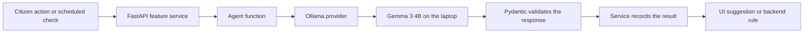

# CivicPulse AI backend implementation and metrics

This guide follows the actual code from the browser to the model and back. Use the **Vision trace** first. The other agents use the same provider and validation pattern, with different triggers and effects.

## 1. Where the code lives

| Layer | File | What to look for |
|---|---|---|
| Browser actions | [Complaint API calls](../frontend/src/features/complaints/api.ts), [React Query hooks](../frontend/src/features/complaints/hooks.ts) | These turn a click or a page step into an HTTP request. The browser sends an evidence ID after upload, rather than calling Ollama itself. |
| HTTP entry point | [Next.js rewrites](../frontend/next.config.ts), [FastAPI app](../backend/app/main.py), [API router](../backend/app/api_router.py) | Next.js forwards `/api/v1/…` to FastAPI. FastAPI registers the feature routers and applies request and session checks. |
| AI business logic | [AI service](../backend/app/modules/ai/service.py) | Loads the input, calls the agent function, records the result or error, and returns a response to the calling feature. |
| Agent implementations | [Vision](../backend/app/modules/ai/agents/vision_agent.py), [Complaint Writer](../backend/app/modules/ai/agents/complaint_writer_agent.py), [Monitoring](../backend/app/modules/ai/agents/monitoring_agent.py), [Resolution](../backend/app/modules/ai/agents/resolution_agent.py) | Each file builds the message for a specific task and selects its prompt and output type. |
| Prompt and output contracts | [Versioned prompts](../backend/app/modules/ai/prompts), [Pydantic schemas](../backend/app/modules/ai/schemas.py) | The prompt describes the job. The schema lists required fields and allowed values so backend code can consume the result safely. |
| Model selection and actual model call | [Provider factory](../backend/app/integrations/ai_providers/factory.py), [Ollama provider](../backend/app/integrations/ai_providers/ollama_provider.py#L32) | `get_ai_provider()` chooses the implementation. `OllamaProvider.generate_structured()` sends the HTTP request that runs Gemma. |
| Persistent records | [AI analysis model](../backend/app/modules/ai/models.py), [database guide](database.md) | `ai_analyses` stores the result or failure. Feature tables store the complaint, evidence, communications, schedules and repair reviews. |



## 2. The exact line that calls the model

The current local setup uses `AI_PROVIDER=ollama` and `OLLAMA_MODEL=gemma3:4b`. Settings come from the repository-root `.env`. FastAPI uses dependency injection to pass the provider to route handlers. The scheduled worker gets the provider from the same factory.

There are two calls worth pointing out in your presentation.

1. **The agent calls the provider interface.** Open [`vision_agent.py:11`](../backend/app/modules/ai/agents/vision_agent.py#L11). `analyze_photo(provider, image)` calls `provider.generate_structured()` with task `vision.v1`, the system prompt, the image and user instructions, and `output_schema=VisionAnalysis`. This is where the application defines the Vision agent's job.
2. **The provider calls the running model.** Open [`ollama_provider.py:50`](../backend/app/integrations/ai_providers/ollama_provider.py#L50). It builds a `POST http://127.0.0.1:11434/api/chat` request. The call at [`ollama_provider.py:68`](../backend/app/integrations/ai_providers/ollama_provider.py#L68) sends it to Ollama. Ollama loads or reuses Gemma and runs inference locally. The backend waits for the full response because `stream` is false.

Here is a shortened view of the JSON sent to Ollama. The actual request includes the full prompt and full schema.

```json
{
  "model": "gemma3:4b",
  "messages": [
    {"role": "system", "content": "Task instructions from the versioned prompt"},
    {"role": "user", "content": "Instructions and task input", "images": ["BASE64_JPEG"]}
  ],
  "format": {"type": "object", "properties": {"category": {"type": "string"}}},
  "stream": false,
  "options": {"temperature": 0, "num_predict": 16000}
}
```

Images are encoded as Base64 because Ollama accepts them inside JSON. The text tasks have no image input. The provider generates the real JSON Schema from `output_schema.model_json_schema()` and passes it in `format`. It then calls `output_schema.model_validate_json()` on the returned `message.content`. This second validation matters even when the model is asked to use the schema. A malformed, truncated, timed-out or unavailable response becomes a provider error, which the calling service handles.

**Training and inference.** Gemma already has pretrained weights. CivicPulse uses those weights to generate answers at runtime. Its own work is image preparation, prompts, schema validation, orchestration and domain rules. All four agents share the same configured model. Switching to `mock` selects a deterministic provider, whose Vision result is a preset. Selecting `anthropic` uses the separately implemented Claude adapter and requires a server-side key. [Config](../backend/app/core/config.py), [provider interface](../backend/app/integrations/ai_providers/base.py).

## 3. Vision agent, from upload to on-screen result

1. **Upload.** The browser sends the file to `POST /api/v1/complaints/{id}/evidence`. The [evidence service](../backend/app/modules/evidence/service.py) checks ownership, validates the file, strips embedded metadata such as EXIF/GPS, stores the cleaned image in private storage and returns an `evidence_id`. PostgreSQL keeps the file key and metadata.
2. **Trigger.** The [Details step](../frontend/src/features/complaints/report-wizard/details-step.tsx#L85) checks whether the current photo has a successful analysis. If it needs one, `runAnalysis(photo.id)` invokes the [mutation hook](../frontend/src/features/complaints/hooks.ts#L174), which posts `{"evidence_id":"…"}` to `/api/v1/complaints/{id}/analysis`. **Analyse again** uses the same endpoint.
3. **Route and service.** [`ai/router.py`](../backend/app/modules/ai/router.py#L30) receives the request with the current user, database session, storage and provider. [`ai/service.py:159`](../backend/app/modules/ai/service.py#L159) checks that the complaint is owned and editable and the requested photo is an original attached to it. It reads the stored bytes.
4. **Preparation and inference.** [`image_prep.py`](../backend/app/modules/ai/image_prep.py#L16) converts the image to RGB and JPEG and limits the longest edge to 1,568 pixels while keeping the aspect ratio. The agent passes those bytes to Ollama with [`vision.v1`](../backend/app/modules/ai/prompts/vision_v1.py). The prompt defines categories such as `ROAD_POTHOLE`, `BROKEN_STREETLIGHT` and `OPEN_DRAIN`, and asks the model to describe visible evidence and uncertainty.
5. **What detection means.** Gemma interprets the image and returns a scene-level category and description. For a possible pothole, a visible break in the road surface can support a category suggestion, while depth or cause may remain unknown. CivicPulse has no custom object detector, bounding box, segmentation mask or GPS inference. A non-civic image can return `is_civic_issue=false`, `category=OTHER` and `severity=UNKNOWN`.
6. **Result and fallback.** The [`VisionAnalysis` schema](../backend/app/modules/ai/schemas.py#L38) includes category confidence, title, description, severity, observations, uncertainties and warnings. The service records the validated result in `ai_analyses`, adds a timeline event and returns it to the browser. The UI offers suggestions while preserving existing input. The citizen can enter details manually if the call fails, and confirms the location separately.

## 4. Complaint Writer agent

- **Trigger and route.** The [Letter step](../frontend/src/features/complaints/report-wizard/letter-step.tsx#L60) requests generation when there is no existing draft. It calls `POST /api/v1/complaints/{id}/complaint-draft` with `mode: "ai"`. The [AI service](../backend/app/modules/ai/service.py#L220) checks ownership, editability, required fields and confirmed location. Replacing an existing letter requires confirmation.
- **Agent and prompt.** [`complaint_writer_agent.py`](../backend/app/modules/ai/agents/complaint_writer_agent.py#L14) calls `write_letter_prose()` with `complaint_letter.v1`. The input is saved facts serialized as JSON in a delimited `<facts>` block. The facts include issue details and location; name and exact coordinates follow the citizen's privacy settings.
- **Output and saved state.** `ComplaintLetterProse` contains `subject`, `issue_summary` and `requested_action`. [`letter_template.py`](../backend/app/modules/ai/letter_template.py#L99) combines that prose with facts read from the database. The service saves the letter draft and withdraws earlier approval on regeneration. If generation fails, the citizen can choose `mode: "template"` and edit the result.

The [department matcher](../backend/app/modules/authorities/matcher.py) uses category and city/state/country rules over directory records. The [communications service](../backend/app/modules/communications/service.py#L146) hashes the recipient, content and attachments the citizen saw. Any content edit withdraws approval. [Sending](../backend/app/modules/communications/service.py#L290) rechecks the approved content, uses locking and an idempotency key, and calls the simulated email provider. The complaint becomes `SUBMITTED` and the outgoing communication records `SIMULATED_SENT`.

## 5. Monitoring agent, two entry points

### A. A department reply triggers classification

1. The demo UI calls `POST /api/v1/complaints/{id}/simulation/reply`. The [monitoring router](../backend/app/modules/monitoring/router.py#L71) calls the simulation service, which feeds a sample reply into [`receive_reply()`](../backend/app/modules/monitoring/service.py#L223). The inbound message is saved in `communications`. The current app uses a simulated reply source.
2. `receive_reply()` calls [`ai.service.classify_reply()`](../backend/app/modules/ai/service.py#L298), which calls [`monitoring_agent.classify_reply()`](../backend/app/modules/ai/agents/monitoring_agent.py#L22). The agent includes the complaint reference and wraps the subject and up to 8,000 body characters as data inside `<reply>`. The prompt is `reply_classification.v1`. The model returns kind, confidence, optional reference and summary.
3. The backend verifies that a suggested reference appears verbatim in the reply and meets the format rules. A deterministic parser can also find it. [`monitoring/rules.py`](../backend/app/modules/monitoring/rules.py) translates an accepted kind into a workflow effect. An acknowledgement can move a case to `ACKNOWLEDGED`. Work underway can move it to `IN_PROGRESS`. A repair claim can move it to `RESOLVED_PENDING_VERIFICATION`. A low-confidence or failed analysis leaves classification to the citizen, whose selection is processed by the same rules.

### B. An overdue check triggers reminder drafting

1. Sending a complaint schedules a check in `scheduled_actions`. The first deadline uses the department's listed response time or the configured default. The [worker script](../backend/app/workers/run_pending.py#L33) calls `run_due_actions()`. The demo button **Skip ahead to the next check** exercises that scheduling path.
2. [`_run_followup_check()`](../backend/app/modules/monitoring/service.py#L521) rechecks whether the complaint is still waiting, a relevant reply arrived, a reply needs review or a draft already exists. Workers claim due rows with `FOR UPDATE SKIP LOCKED`, and a draft has a unique key tied to the check.
3. If the case is eligible and below the reminder cap, [`_create_followup_draft()`](../backend/app/modules/monitoring/service.py#L563) builds the facts and calls [`monitoring_agent.write_followup_prose()`](../backend/app/modules/ai/agents/monitoring_agent.py#L39) through the AI service. The `followup_letter.v1` prompt requests `opening` and `requested_action`. The backend template inserts references and dates. AI failure switches to template wording.
4. The worker saves an outbound `FOLLOW_UP` communication in `DRAFT`. The citizen may approve, send or dismiss it. At the configured cap, two sent reminders by default, an eligible check recommends escalation using directory contacts.

## 6. Resolution agent

1. **Trigger.** The [frontend hook](../frontend/src/features/complaints/hooks.ts#L360) uploads the after photo to `/followup-evidence` and posts its ID to `/api/v1/complaints/{id}/resolution-reviews`. The [resolution service](../backend/app/modules/resolutions/service.py#L114) checks eligibility and ownership, takes the original and chosen follow-up photos, and reuses a successful review of the same photo when available.
2. **Inference.** [`ai.service.compare_photos()`](../backend/app/modules/ai/service.py#L356) prepares both images with Pillow. [`resolution_agent.compare_photos()`](../backend/app/modules/ai/agents/resolution_agent.py#L11) passes the BEFORE photo first and AFTER photo second, with their labels and the `resolution.v1` prompt. The provider puts both Base64 images into the same Ollama request in that order.
3. **Result and decision.** `ResolutionAssessment` stores likely same location, confidence, visible changes, remaining issues, uncertainties and an assessment such as `CANNOT_DETERMINE`. The feature saves the advice in `resolution_reviews`. A separate [decision endpoint](../backend/app/modules/resolutions/router.py#L58) accepts the citizen's confirmation. The backend can record `VERIFIED_RESOLVED` or move a disputed repair to `REOPENED` and draft an unsent notice. If the model is unavailable or the original photo is missing, the citizen can still check manually.

## 7. Metrics you can show

### Verified application and local integration results

These observations cover software behavior and a small local smoke run. The application test suites exercise rules, HTTP behavior and frontend interactions using controlled providers. The Ollama smoke run exercised pretrained Gemma directly with synthetic images and sample text.

| Metric | Observed result | What it measures |
|---|---:|---|
| Backend automated suite, after Ollama integration | 478 passed | Application and domain behavior with controlled providers |
| Frontend unit suite | 119 passed | Frontend behavior and validation |
| Targeted Ollama and AI workflow tests | 77 passed | Provider request formatting and error handling, plus AI, monitoring and repair workflows |
| Local Gemma smoke run | 6 of 6 returned schema-valid output | Two Vision inputs and one input each for letter, reply, reminder and repair comparison |
| Full proxy upload-to-analysis smoke check | Passed | Next.js and FastAPI reached Ollama and displayed a validated non-civic `OTHER` result for an apple drawing |

The smoke run returned `IN_PROGRESS` and reference `RD-1234` for a sample reply that said repair work had started. The mismatched synthetic image pair produced `CANNOT_DETERMINE`, with some inaccurate visual descriptions. The reminder sample also added an acknowledgement that the supplied facts did not establish. These examples show why schema validity and factual correctness need different measurements.

### Local provider response times from that smoke run

| Call | Time |
|---|---:|
| Vision, first request including cold model load | 91.47 s |
| Vision, next image with model loaded | 13.57 s |
| Complaint letter draft | 9.43 s |
| Reply classification | 6.36 s |
| Reminder draft | 6.09 s |
| Two-image repair comparison | 25.16 s |

Each time is one provider-call observation on the local laptop. The provider starts a monotonic timer before the HTTP request to Ollama and records the elapsed time after validation. These timings include local HTTP and inference, plus model load on a cold call. They exclude browser upload and the rest of the complaint workflow. Separate cold and warm requests when gathering a larger sample.

### Model quality to measure before claiming accuracy

| Task | Suggested metric | How to compute it |
|---|---|---|
| Photo issue classification | Macro-F1, per-category precision and recall | Compare predictions against human-labelled civic photos, including non-civic and ambiguous photos. Macro-F1 averages class-level F1 equally. |
| Reply classification | Macro-F1 and reference match rate | Compare reply kinds to labelled examples. Count references accepted only when the exact expected value appears in the reply. Include auto-replies and unrelated text. |
| Letter and reminder prose | Factual consistency and unsupported claim rate | Compare each factual statement against the saved inputs. Have reviewers flag invented dates, acknowledgements, locations and obligations. |
| Repair advice | Agreement with human reviewers and false resolved rate | Use labelled before/after pairs, including partial repairs and different locations. Count incorrect `APPEARS_RESOLVED` outputs where a repair remains incomplete. |
| Reliability and speed | Schema success rate, timeout rate, p50 and p95 latency | Divide success and failure counts by total attempts. Measure cold and warm latency separately by task on a fixed hardware/model setup. |

Keep labelled evaluation cases separate from prompt tuning. Record the model tag, prompt version, hardware and number of examples with every result. The current project has smoke observations and application test counts. Accuracy, macro-F1, false-resolved rate and latency percentiles still need a benchmark.

### Where metrics are stored

[`_record_success()`](../backend/app/modules/ai/service.py#L87) and [`_record_failure()`](../backend/app/modules/ai/service.py#L116) write `ai_analyses`. Successful calls can include `latency_ms`, input/output token counts, the provider, the model, the prompt version and `is_mock`. Failures record an error code. The table has model outputs and operational telemetry. To measure correctness, join the outputs to human labels from a separate evaluation set.

```sql
SELECT analysis_type,
       model,
       prompt_version,
       count(*) AS attempts,
       count(*) FILTER (WHERE status = 'SUCCEEDED') AS schema_valid,
       count(*) FILTER (WHERE error_code = 'TIMEOUT') AS timeouts,
       round(avg(latency_ms) FILTER (WHERE status = 'SUCCEEDED'), 1) AS mean_success_ms
FROM ai_analyses
WHERE provider = 'ollama' AND is_mock = false
GROUP BY analysis_type, model, prompt_version
ORDER BY analysis_type, model, prompt_version;
```

The query gives operational results for persisted attempts. The direct smoke calls above bypassed the database, so their measured times will not appear in this query.

## 8. What to show live in the IDE

1. Open [`vision_agent.py`](../backend/app/modules/ai/agents/vision_agent.py#L11) and point to `provider.generate_structured`. Say, “This agent chooses the prompt, the photo and the expected output.”
2. Open [`factory.py`](../backend/app/integrations/ai_providers/factory.py#L11) and [`ollama_provider.py`](../backend/app/integrations/ai_providers/ollama_provider.py#L32). Say, “The factory selects Ollama. This provider sends the actual local HTTP request to Gemma and validates the JSON.”
3. Open [`ai/service.py`](../backend/app/modules/ai/service.py#L159). Say, “The service finds the authorized photo, prepares it, invokes the agent and saves the answer.” Then show the corresponding suggestion in the browser.
4. Open [`monitoring/service.py`](../backend/app/modules/monitoring/service.py#L521). Say, “After a deadline, this rule checks if a reminder is still needed. Only then does it call the writing task. The result waits for citizen approval.”
5. Finish with the metrics table. Say, “We verified the application and local inference path. A labelled benchmark is the next step for model quality.”
