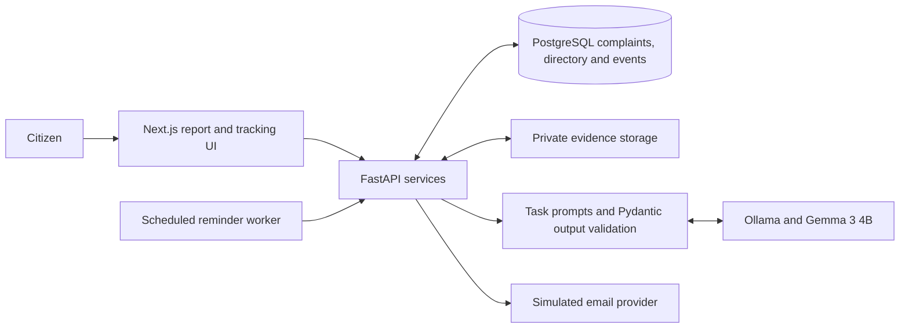

# CivicPulse AI · Generative AI project design

[GitHub repository](https://github.com/anant-arya-03/CivicPulse-AI) · [Run the app](../README.md#8-getting-started) · [Evaluation evidence](../output/model-evaluation/README.md)

## 1. Problem and users

A citizen who notices a public infrastructure issue needs to describe it, reach the responsible department and track the outcome. CivicPulse helps the citizen turn a photo and confirmed details into an editable complaint, follow up, and verify the repair. Success means the citizen can review a useful draft, identify its recipient, and control submission and closure. The citizen must never receive an invented contact, a simulated delivery presented as real, or a message sent without their approval.

## 2. Why generative AI

The course template refers to five criteria without naming them. This design uses the following five questions to explain the choice.

| Criterion | Design decision |
|---|---|
| Variable inputs | Images and free-text descriptions vary across reports. A multimodal model can suggest a category and describe visible evidence. |
| Useful generated output | A model can write a subject, issue summary and requested action adapted to the report. |
| Grounding | Letter prompts use confirmed facts. The renderer inserts the reference and location from the application, and the directory lookup uses fixed rules. |
| Error tolerance | Drafts and suggestions are editable. Citizens review the exact message and decide whether a repair is complete. |
| Baseline and cost | The deterministic letter template provides a comparison and a fallback. Local inference trades cloud API charges for laptop compute and latency. |

The project uses task-specific prompting and structured generation with pretrained Gemma 3 4B through Ollama. It does not use RAG or fine-tuning. The department lookup is a database operation. The backend orchestrates the four AI components directly without an agentic framework.

## 3. Scope

The classroom workflow covers photo suggestions, manually confirmed location, department selection, letter drafting, approval, simulated delivery and replies, reminders, and citizen repair verification. The demo uses a fictional department directory. Where there is no geographic match, simulation-enabled users can explicitly select a fictional department. Citizens can complete the workflow manually if inference fails. Real government delivery, model training, and public deployment are outside the classroom demo.

## 4. Requirements

| Requirement | Acceptance check or target |
|---|---|
| Report and draft | Upload an image and receive editable structured suggestions, or enter the issue manually. Generate a letter or use the template. |
| Location and recipient | Citizen enters and confirms location. Recipient comes from the directory. |
| Approval and delivery | Edit an approved draft and verify approval is withdrawn. Reapprove before simulated submission. Delivery must be labelled as simulated. |
| Follow-up and resolution | An overdue check creates a draft. A repair claim can reach pending verification. The citizen alone verifies or disputes the repair. |
| Latency | Proposed classroom targets are warm letter inference within 20 s and warm photo inference within 45 s. Cold start is measured separately. Keep the manual path usable on timeout. |
| Data freshness | Demo directory is stable. Real entries require an official source and verification date. Define a review cadence before any real pilot. |
| Privacy | Strip photo metadata, keep evidence private and respect citizen sharing preferences. Use synthetic or consented inputs for evaluation. |
| Licensing and cost | Record provenance and usage terms for model, dependencies and any shared evaluation assets before distribution. Demo inference uses the local laptop with zero per-call cloud API fees. |

## 5. Architecture and tech stack

The TypeScript and React UI collects citizen input and exposes drafts for review. Python and FastAPI enforce ownership, state transitions and approval. PostgreSQL and SQLAlchemy persist facts and audit events. Pillow prepares images. The AI layer uses task-specific prompts and Pydantic schemas. The reminder worker creates drafts. The server allows submission only after approval of the exact message.

## 6. Failure modes and guardrails

| Failure | Control and residual risk |
|---|---|
| Image mislabeled or overinterpreted | Editable suggestions and manual entry. A correct label can still come with a misleading description. |
| Fluent draft contains a false claim or misses the needed action | Confirmed inputs, templated facts, schema checks and citizen review. Schema validation cannot verify meaning. |
| Reply text contains misleading instructions | Treat text as untrusted data and constrain outputs. Fixed rules limit status effects and the citizen keeps final verification. |
| Model unavailable or slow | Manual input, deterministic wording and manual verification remain available. |

## 7. Evaluation plan and observed results

Run labelled vision cases across issue categories, unrelated images and ambiguous inputs. Score category match separately from uncertainty and unsupported descriptions. For letters, compare the first model draft and deterministic template on identical facts. Have reviewers check fact preservation and action relevance. For reminders, include no-reply and replied cases. For reply classification, measure label agreement and verbatim reference retention. For repair advice, include unresolved and mismatched pairs and count false resolved suggestions separately.

On 25 November 2026, the controlled evaluation passed 8 of 10 task checks and 10 of 10 schema checks. Vision passed 5 of 6. Gemma passed 2 of 3 letter checks and the template passed 3 of 3. The no-reply reminder passed. The waste letter omitted the immediate cleanup request. This run used synthetic images, fictional facts and one reviewer. Reply classification and repair advice were outside this evaluation.

Proposed criteria for a future pilot are at least 90% schema-valid responses and 90% relevant, fact-preserving drafts on a larger held-out set, plus zero unapproved sends and zero model-only repair decisions in workflow tests. Record timeouts and warm versus cold latency by task. Use a second reviewer on ambiguous cases and resolve disagreements before reporting pilot results.

## 8. Open questions and risks

How well do the suggestions transfer to real low-light photos and different neighbourhoods? Test on consented, labelled inputs. Does generated wording save citizen editing time compared with the template? Time both paths with volunteer reviewers. Are model warm-up and inference predictable on demo hardware? Rehearse on the presentation laptop and have a previously evaluated output ready.

## 15-minute demo

| Time | What to show |
|---|---|
| 0–2 min | Use case, intended users and GitHub link |
| 2–4 min | Architecture, prompting decision and deterministic baseline |
| 4–9 min | Show one new photo-to-letter example. Use a prepared case to show a simulated reply and repair advice. |
| 9–11 min | Show the template comparison and explain the omitted cleanup request. |
| 11–15 min | Audience questions |
